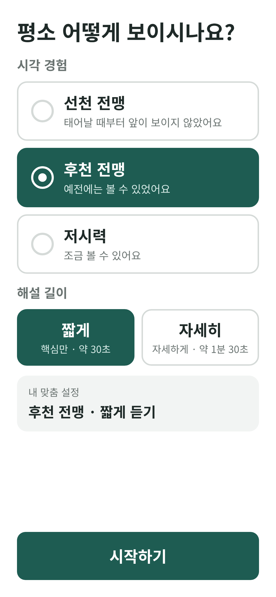
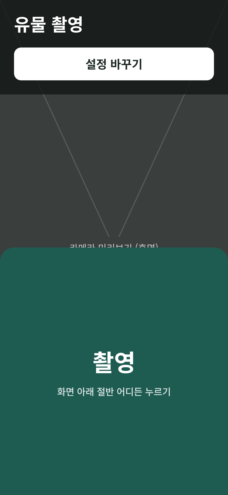
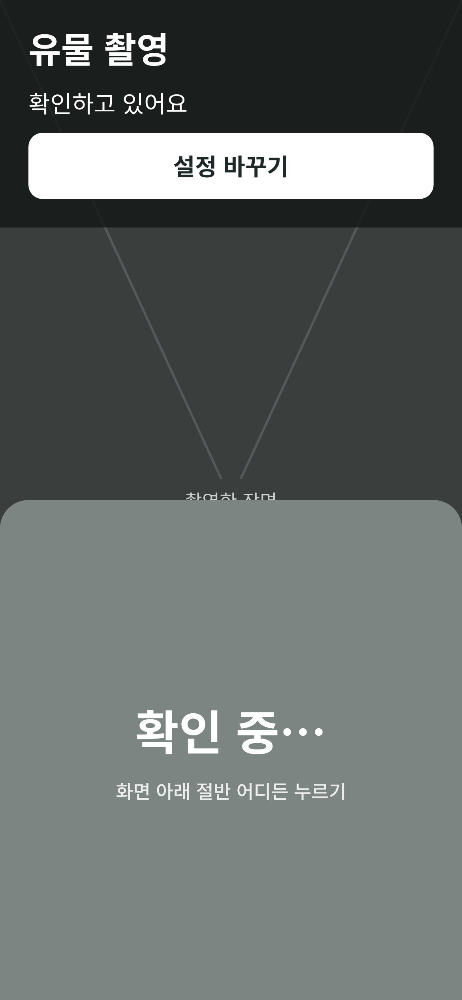
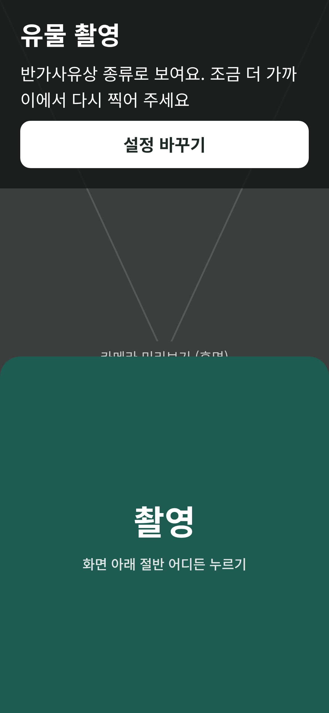
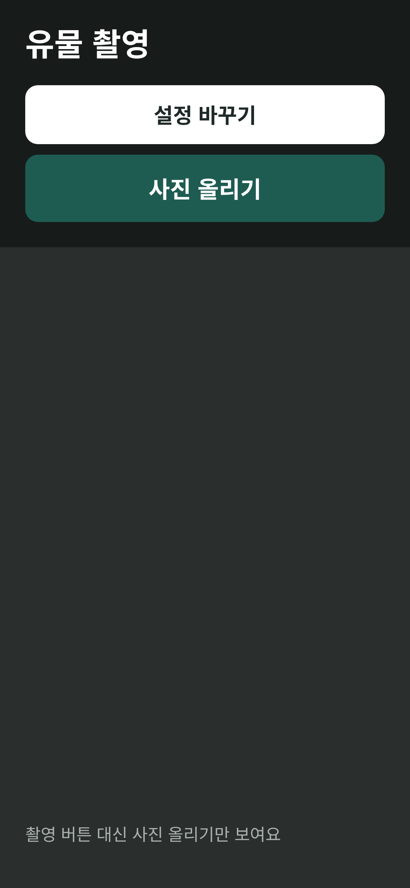
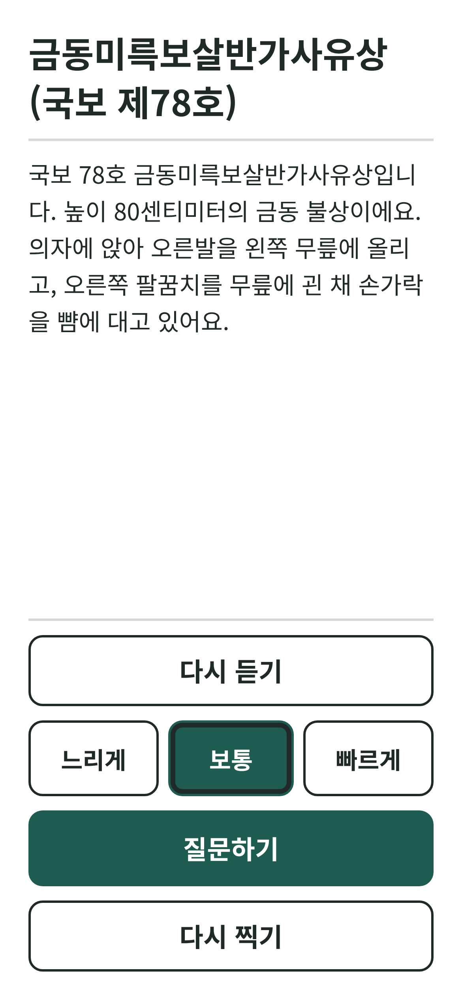
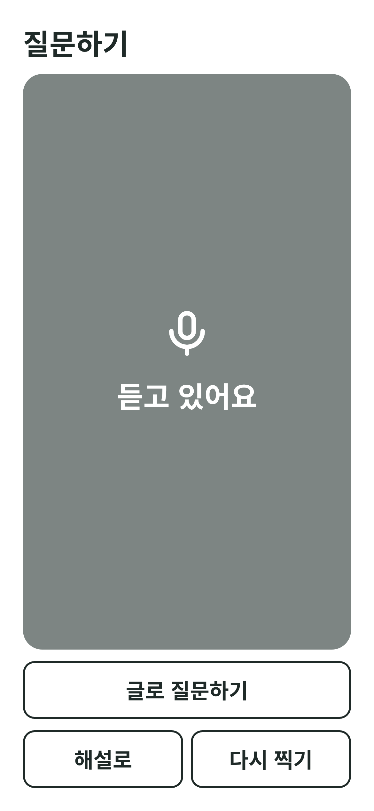
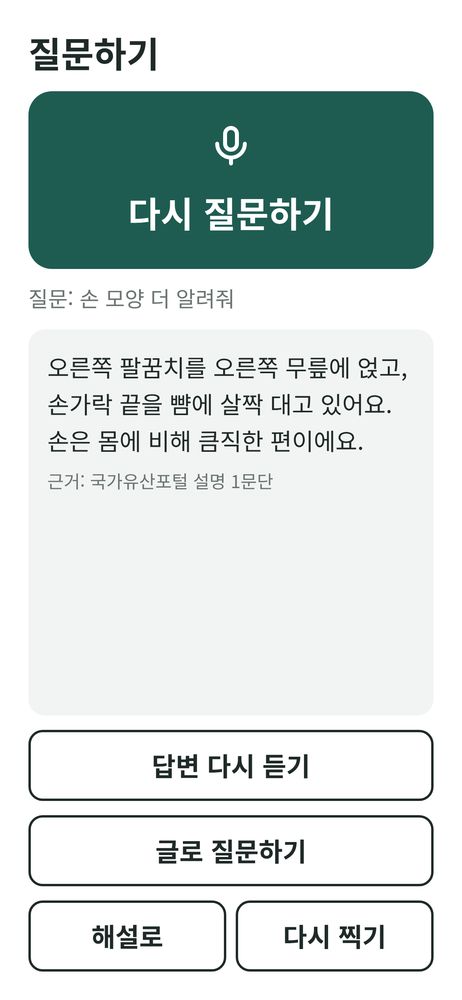

# UI 와이어프레임 (화면 8개)

흑백 와이어프레임이라 실제 앱 색(검정 배경·앰버 강조, `frontend/src/styles/tokens.css`)과는 다르다. 화면 구성과 문구는 코드와 같다.
1번 온보딩(한 화면)은 PR #24 기준이다.

## 화면

| ① 시작 → 촬영 | | |
|:---:|:---:|:---:|
|  **1 온보딩** |  **2 촬영** |  **3 촬영 · 확인 중** |

| ② 촬영 예외 상태 | |
|:---:|:---:|
|  **4 재촬영 안내** |  **5 카메라 없음 → 사진 올리기** |

| ③ 해설 → 질문 | | |
|:---:|:---:|:---:|
|  **6 해설** |  **7 질문 · 듣는 중** |  **8 질문 · 답변** |

## 화면별 서버 호출

모든 호출은 `frontend/src/api.ts`를 거친다. 실패(타임아웃·연결 오류·2xx 아님)하면 **1회 자동 재시도**하고, 그래도 실패하면 화면이 "연결이 불안정해요. 다시 시도해 주세요"를 읽는다.

| 화면 | 호출 | 보내는 값 | 화면이 쓰는 응답 | 타임아웃 |
|---|---|---|---|---|
| 1 온보딩 | 없음 | — | — | — |
| 3 확인 중 | `POST /recognize` | `image`: JPEG, 긴 변 768px (multipart) | `status`, `name`, `message` | 5초 |
| 6 해설 | `GET /narration` | `artifact_id`, `profile`, `length` | `text` | 5초 |
| 8 답변 | `POST /ask` | `artifact_id`, `profile`, `question` (JSON) | `answer`, `sources`, `grounded` | 15초 |

## 백엔드가 알아 둘 프론트 동작

- **온보딩 설정은 서버에 저장하지 않는다.** 시각 경험(`congenital` / `acquired` / `low_vision`)과 해설 길이(`short` / `long`)는 폰의 localStorage에만 있고, `/narration`·`/ask`를 부를 때 값으로 실려 간다.
- **`/recognize`의 `status`로 화면이 갈린다.**
  - `ok` → 6 해설로 이동. 제목에 `name`을 그대로 표시한다.
  - `uncertain`, `reject` → 4 재촬영 안내. 서버의 `message`를 그대로 화면에 띄우고 읽는다 (없을 때만 프론트 기본 문구). 문구를 바꾸려면 `backend/app/recognize.py`의 `MESSAGES`를 고친다.
- **`/narration`이 404면** 해설 화면이 "해설을 불러오지 못했어요"를 읽는다. `reviewed: true`인 해설만 나간다.
- **`/ask`의 `grounded: false`** 면 `answer`("자료에 없는 내용이에요")를 그대로 읽고 근거는 표시하지 않는다.
- **3초 목표:** 촬영 버튼부터 해설 음성 시작까지. `/recognize`와 `/narration` 왕복(ngrok 포함)이 이 안에 들어와야 한다. 프론트는 `/recognize` 소요 시간을 브라우저 콘솔에 `[timing]`으로 찍는다 (#12 측정용).

## 원본

- 디자인 캔버스와 화면 명세 문서는 혜진 계정에 있다. 수정이 생기면 이 폴더의 이미지와 표를 함께 갱신한다.
